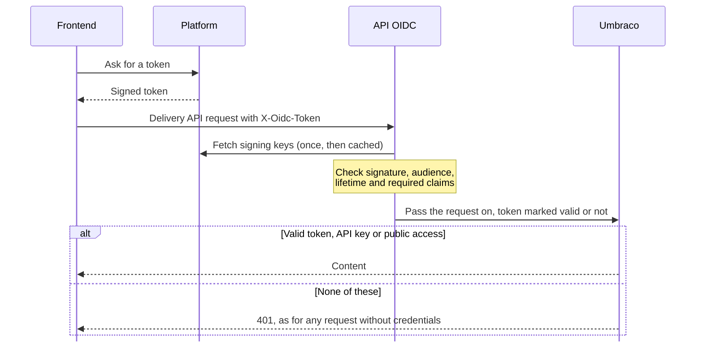

1. A middleware runs at the start of Umbraco's pipeline. For requests under `/umbraco/delivery/api` that carry the header, it finds the trusted issuers matching the token's `iss`, and validates the signature against the keys that issuer publishes. Then it checks the audience, the lifetime and the claims the issuer entry requires.
2. The package replaces Umbraco's `IApiAccessService` with one that grants access when step 1 found a valid token, and otherwise applies Umbraco's own rules unchanged.

A refused token is logged as a warning with the reason, and the request carries on. Umbraco then answers it as it would any request without credentials.

On your own endpoints, an ASP.NET Core authentication handler does the same validation, and only for endpoints that require it.
